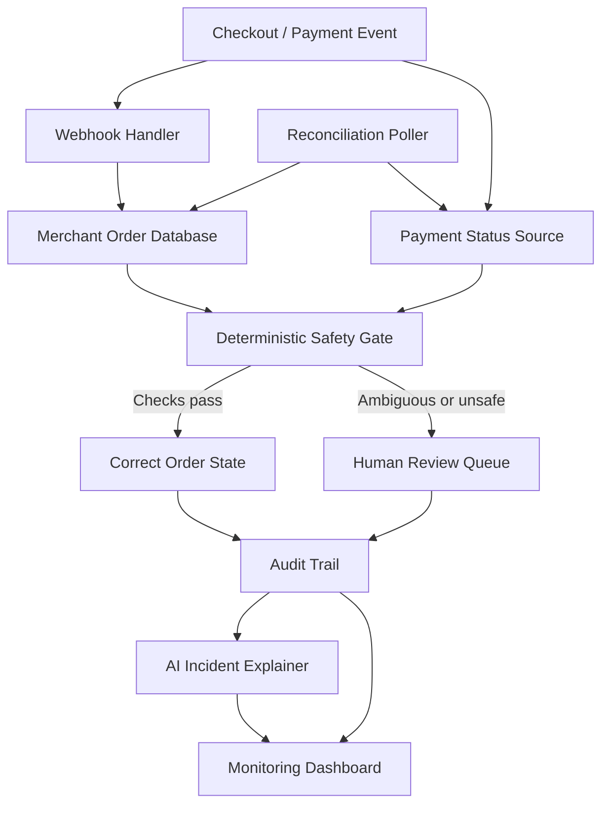

# 👻 Ghost Payment Detector

<p align="center">
  <strong>Detect missing payment events. Reconcile order states. Recover safely.</strong>
</p>

<p align="center">
  
  
  
  
  
</p>

**Ghost Payment Detector** is an independent personal project exploring a common reliability issue in online payments: a payment succeeds, but the merchant's application misses the event that should update the order. The customer may have paid while the order remains stuck in a pending state.

The project simulates webhook failures, reconciles local order records with payment status, applies strict checks before changing an order, and records decisions for review. An optional AI explainer turns technical incidents into readable summaries; it does **not** decide whether a payment succeeded or authorize financial state changes.

---

## ✨ Why this project?

Online payment workflows often rely on asynchronous webhooks. Network interruptions, server restarts, or delayed delivery can leave the payment service and merchant application showing different states.

**Example:** A customer completes checkout. The payment is captured, but the webhook never reaches the merchant server. The order remains pending, potentially delaying fulfillment and confusing the customer.

Ghost Payment Detector explores how to identify and resolve this mismatch without blindly trusting an event, an AI-generated answer, or an unverified status.

## 🚀 Key features

| Feature | What it does |
| --- | --- |
| **Payment reconciliation** | Finds orders that remain pending and compares their state with the payment status source. |
| **Deterministic safety gate** | Checks whether an order is eligible for a correction before changing its state. |
| **Idempotency protection** | Prevents the same order from being corrected repeatedly. |
| **Webhook failure simulation** | Simulates dropped, delayed, or corrupted events to test failure scenarios. |
| **Human escalation queue** | Sends ambiguous cases—such as amount mismatches or invalid signatures—for review. |
| **Audit trail** | Records reconciliation decisions and correction outcomes for investigation. |
| **AI incident explainer** | Produces plain-language summaries and draft messages after the decision is made. |
| **Monitoring dashboard** | Displays payment states, recovery activity, audit events, and escalations. |
| **Automated tests** | Covers safety-gate decisions, failure simulations, API behavior, and incident explanations. |

## 🛡️ Safety by design

The core principle is simple: **AI can explain a financial incident, but deterministic application logic controls payment-state changes.**

A correction should only be considered when the available evidence is consistent and the required checks pass:

1. **Idempotency:** Has this order already been corrected?
2. **Payment status:** Does the payment source confirm a successful capture?
3. **Integrity:** Is the response verified, and does the amount match?
4. **Order state:** Is the order in a state that is safe to change?
5. **Decision:** Correct only when all required checks pass; otherwise escalate for human review.

The AI explainer runs after the decision and is not the authority for payment status. This separation reduces the risk of an LLM hallucination causing an unsafe financial action.

> This is a personal engineering project and simulation. Do not use it to process real payments or update production financial records without a security review, provider-specific verification, authorization controls, and operational testing.

## 🧭 How it works



### Typical incident lifecycle

1. A payment is captured, but its webhook is dropped or delayed.
2. The order remains pending beyond the configured threshold.
3. The reconciliation poller checks the payment status.
4. The safety gate compares status, amount, integrity checks, and current order state.
5. The system either corrects the order or sends the case for human review.
6. The decision is recorded, and the explainer can summarize what happened.

## 🏗️ Architecture and tech stack

- **Backend:** Python, FastAPI, Pydantic
- **Frontend:** React, Vite, Tailwind CSS
- **Database:** SQLite
- **AI explanations:** LLM integration with structured-output handling and fallback explanations
- **Background processing:** Reconciliation poller
- **Reliability testing:** Pytest and simulated webhook failures

### Repository layout

```text
.
├── backend/
│   ├── app/
│   │   ├── api/          # Dashboard, webhook, audit, simulation, escalations
│   │   ├── gate.py       # Deterministic correction checks
│   │   ├── poller.py     # Reconciliation worker
│   │   ├── chaos.py      # Webhook failure simulation
│   │   ├── explainer.py  # AI-assisted incident summaries
│   │   ├── models.py     # Data models
│   │   └── database.py   # Database setup
│   └── tests/            # API, gate, chaos, and explainer tests
├── frontend/
│   └── src/
│       ├── App.jsx
│       └── components/   # Dashboard, audit, simulation, escalation UI
├── docs/
│   └── architecture.png
├── .env.example
└── start.sh
```

## 🖥️ Run locally

### Prerequisites

- Python 3.9 or later
- Node.js 18 or later with npm
- Git

### 1. Get the project

Open this repository on GitHub and use **Code → Clone** or download the source as a ZIP file. Then open a terminal in the project folder.

### 2. Configure environment variables

Create your local environment file from the example:

    cp .env.example .env

Open the new .env file and configure the sandbox payment credentials and optional AI provider key expected by the application. Keep real secrets out of Git. The project supports local simulation when enabled by its configuration.

### 3. Start the application

From the project root, run:

    chmod +x start.sh
    ./start.sh

The start script is configured to launch the services locally. Once startup completes, open:

- **Frontend:** http://localhost:5173
- **Backend API:** http://localhost:8000
- **Interactive API docs:** http://localhost:8000/docs

If you prefer to run the services separately, follow the scripts and dependencies in the backend and frontend folders.

## 🧪 Run the tests

Create and activate a Python virtual environment:

    cd backend
    python -m venv .venv

**macOS / Linux**

    source .venv/bin/activate

**Windows PowerShell**

    .venv\Scripts\Activate.ps1

Install dependencies and run the tests:

    pip install -r requirements.txt
    PYTHONPATH=. pytest -v tests/

The test suite includes scenarios for idempotency, unsuccessful payment states, invalid signatures, amount mismatches, safe correction, webhook chaos, escalation, API behavior, and AI explanation handling.

## 🔍 What this project explores

- Designing safe state transitions for money-related workflows
- Handling asynchronous events and webhook delivery failures
- Building idempotent recovery operations
- Separating deterministic business rules from LLM-generated explanations
- Testing failure scenarios instead of only the happy path
- Creating audit trails and human-review workflows
- Connecting a Python API to a React monitoring interface

## 🗺️ Potential next steps

- Add a recorded demo and screenshots of the current dashboard.
- Add continuous integration to run backend tests on every pull request.
- Add stronger authentication, role-based access, and audit-log integrity checks.
- Expand observability for reconciliation latency and escalation reasons.
- Document the payment adapter interface and add integration tests for sandbox providers.
- Add end-to-end tests that verify the UI and backend together.

## 🔐 Security

- Never commit API keys, secrets, real customer data, or production payment records.
- Use sandbox credentials and synthetic data for testing.
- Verify signatures and amounts on the server; never trust client-provided payment status.
- Require authorization for administrative actions and protect public API endpoints.
- Keep the AI explainer separate from payment-state mutation logic.
- Rotate any secret that has accidentally been committed and review Git history if it was exposed.

## 👤 About

Ghost Payment Detector is an independently developed personal project by **Karan K**, exploring payment reliability, event-driven backend systems, safe automation, and AI-assisted incident analysis.

## 📄 License

No open-source license is currently specified. Unless a license is added, all rights are reserved by the author.
